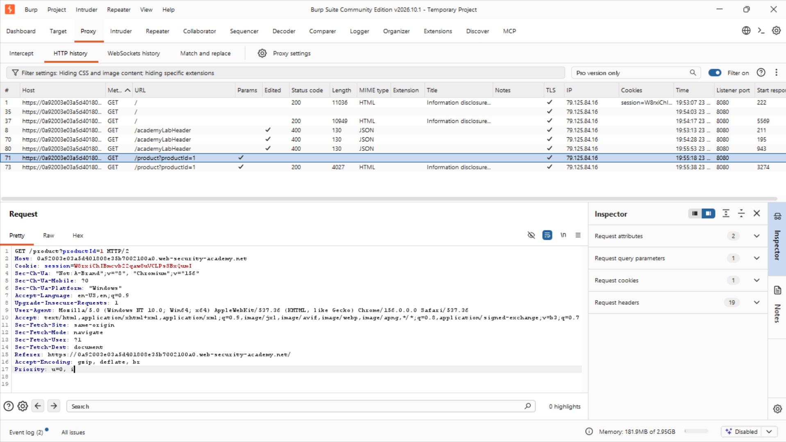
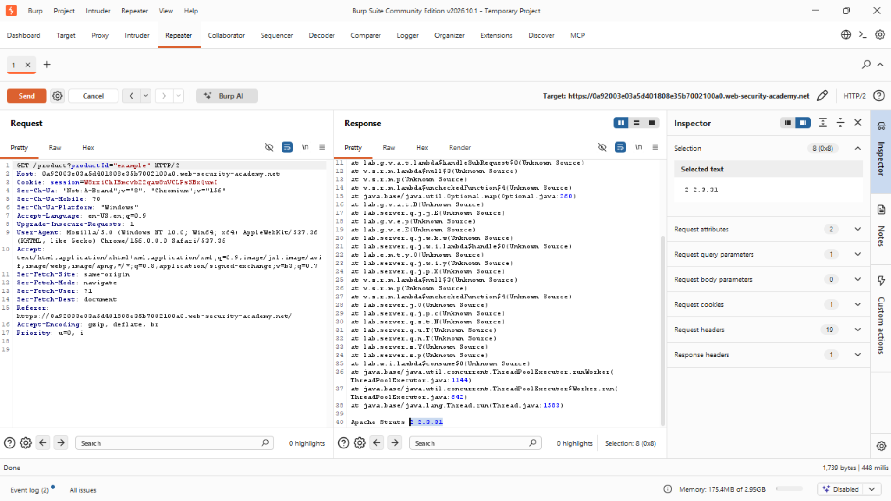
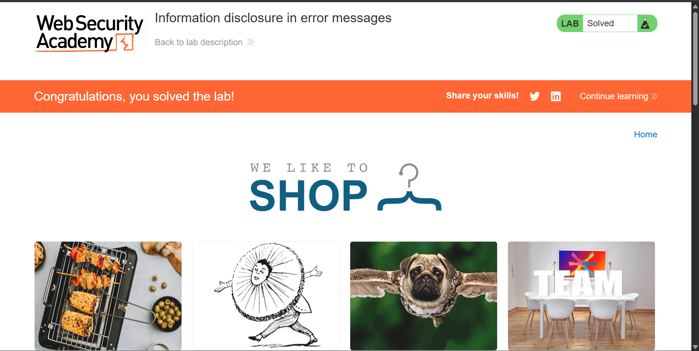

# Information Disclosure in Error Messages

> PortSwigger Web Security Academy lab write-up: extracting a vulnerable framework version from a verbose stack trace.


---

## Table of Contents
- [Overview](#overview)
- [Scope & Objectives](#scope--objectives)
- [Methodology](#methodology)
- [Findings / Results](#findings--results)
- [Attack Chain](#attack-chain)
- [Tools & Environment](#tools--environment)
- [Evidence](#evidence)
- [Lessons Learned](#lessons-learned)
- [References](#references)
- [Author](#author)

---

## Overview

Applications that return detailed error output to users expose internal technology choices. Attackers use this to find known weaknesses without any prior access.

A shop application on the PortSwigger Web Security Academy was tested by sending an unexpected input value to a product page. The server responded with a full diagnostic trace instead of a generic error.

The trace named the framework and exact version in use, which was sufficient to solve the lab.

> **Key Outcome:** Identified the back-end framework version (`Apache Struts 2 2.3.31`) from a single malformed request.

---

## Scope & Objectives

### Objectives
- Trigger an unhandled exception in the product page endpoint.
- Extract the third-party framework name and version from the response.
- Submit the version string to complete the lab.

### In Scope
| Target | Description | Type |
|--------|-------------|------|
| `GET /product?productId=` | Product page endpoint of the lab shop | Web App |

### Out of Scope
- Exploitation of any vulnerability in the identified framework version.
- Other endpoints and parameters of the application.
- Attacks against the Web Security Academy platform itself.

### Engagement Type
> **Type:** Black-box
> **Authorization:** Sanctioned training platform (PortSwigger Web Security Academy)

---

## Methodology

Testing followed the OWASP Web Security Testing Guide approach to error handling (WSTG-ERRH-01), mapped to PTES phases.

| Phase | Activity | Framework Reference |
|-------|----------|-------------------|
| Reconnaissance | Browse the application with Burp proxying traffic | PTES: Intelligence Gathering |
| Enumeration | Identify the `productId` parameter in HTTP history | PTES: Vulnerability Identification |
| Exploitation | Send a non-integer value to force an exception | OWASP WSTG-ERRH-01 |
| Information Extraction | Read the framework version from the stack trace | MITRE ATT&CK: T1592.002 |

> **Note:** All testing was conducted on an authorized training platform. No production systems were accessed.

---

## Findings / Results

### Information Disclosure in Error Messages: Web

| Field | Detail |
|-------|--------|
| **Platform** | PortSwigger Web Security Academy |
| **Difficulty** | Apprentice |
| **Points** | N/A |
| **Category** | Web: Information Disclosure |
| **Flag** | N/A (lab is solved by submitting the version string) |
| **Severity** | [MEDIUM] |
| **CVSS v3.1 Score** | 5.3 |
| **CVSS Vector** | `CVSS:3.1/AV:N/AC:L/PR:N/UI:N/S:U/C:L/I:N/A:N` |
| **CWE** | [CWE-209: Generation of Error Message Containing Sensitive Information](https://cwe.mitre.org/data/definitions/209.html) |
| **OWASP Category** | A02:2025 Security Misconfiguration; A10:2025 Mishandling of Exceptional Conditions |
| **MITRE ATT&CK** | [T1592.002: Gather Victim Host Information: Software](https://attack.mitre.org/techniques/T1592/002/) |
| **Affected Component** | `/product` endpoint, `productId` parameter |

#### Approach

The product page request contains a `productId` parameter that the server expects to be an integer. The test was to supply a value of a different data type and observe how the application handles the resulting exception.

#### Solution Walkthrough

**Step 1: Identify the parameter**

With Burp running, a product page was opened in the browser. The `GET /product?productId=1` request was located in Proxy > HTTP history and sent to Repeater.


*Caption: HTTP history showing the product page request and its `productId` query parameter (Inspector: 1 query parameter).*

**Step 2: Trigger the exception**

In Repeater, the integer value was replaced with a string.

```http
GET /product?productId="example" HTTP/2
```

> **Output:** The server returned a full Java stack trace instead of a generic error page. The final line of the response discloses `Apache Struts 2 2.3.31`.


*Caption: Repeater response with the version string highlighted at line 40 of the stack trace output.*

**Step 3: Submit the solution**

The string `2 2.3.31` was submitted through the lab's "Submit solution" button.


*Caption: Lab status changed to Solved after submitting the identified version.*

#### Key Technique

Forced error disclosure: supplying input of an unexpected type causes an unhandled exception, and the application returns the raw trace to the client. The trace reveals component names and versions that can be matched against public vulnerability databases. See [CWE-209](https://cwe.mitre.org/data/definitions/209.html).

#### Impact

| Type | Description |
|------|-------------|
| Technical | Discloses framework name, version and internal class structure to unauthenticated users. |
| Business | Reduces attacker effort for targeted exploitation. Version `2.3.31` falls within the range affected by `CVE-2017-5638`, so disclosure narrows the search to a known remote code execution issue. |

#### Mitigation
- Return a generic error page with an HTTP 4xx or 5xx status and no stack trace to clients.
- Log full exception details server-side only, keyed by a correlation ID shown to the user.
- Validate `productId` as an integer at the controller and reject other types with a 400 response.
- Disable debug and verbose error modes in production configuration.

#### Retest Criteria
- [ ] A request with `productId="example"` returns a generic error with no framework, class or version information.
- [ ] No response header or body in the application discloses component versions.

#### Tools Used
- Burp Suite Community Edition: traffic interception and request replay.
- Web browser: application navigation.

---

## Attack Chain

```
[Reconnaissance] -> [Enumeration] -> [Input Manipulation] -> [Information Extraction]
       |                  |                   |                        |
   Browse shop      Find productId     Send string value        Read version from trace
```

| Stage | Technique | Tool | MITRE ATT&CK TTP |
|-------|-----------|------|-------------------|
| Reconnaissance | Browse application, capture traffic | Burp Proxy | T1595 |
| Discovery | Gather software version from error output | Burp Repeater | T1592.002 |

---

## Tools & Environment

### Environment
| Component | Specification |
|-----------|---------------|
| **OS / Platform** | Windows, Chromium-based browser |
| **Target** | PortSwigger Web Security Academy lab instance |
| **Network** | Internet to hosted lab, proxied through Burp on port 8080 |

### Tools Used
| Tool | Version | Purpose |
|------|---------|---------|
| Burp Suite | Community 2026.10.1 | Traffic interception and request replay |

---

## Evidence

All supporting evidence is organized in the `/evidence/` directory.

| Reference | File | Description |
|-----------|------|-------------|
| Parameter discovery | `evidence/vuln-001-http-history.png` | HTTP history with `GET /product?productId=1` selected |
| Version disclosure PoC | `evidence/vuln-001-poc-stacktrace.png` | Repeater request with `productId="example"` and response trace ending in `Apache Struts 2 2.3.31` |
| Lab completion | `evidence/lab-solved.png` | Lab banner showing Solved status |

> **Note:** The session cookie visible in the request panes belongs to a temporary lab session. It should be redacted before publishing.

---

## Lessons Learned

### Technical Takeaways
- A single type-mismatch input is enough to expose unhandled exception paths.
- Stack traces disclose component versions that map directly to public CVE data.
- Error handling is a security control, not only a usability feature.

### What I Would Do Differently
- Annotate screenshots with highlights on the `productId` parameter and the version line before publishing.
- Test additional parameter types (null, array, oversized values) to check whether other handlers leak different details.

### Skills Demonstrated
> `Burp Suite` `HTTP Request Manipulation` `Error Handling Analysis` `Information Disclosure` `OWASP WSTG` `CWE/MITRE Mapping`

---

## References

- [PortSwigger Lab: Information disclosure in error messages](https://portswigger.net/web-security/information-disclosure/exploiting/lab-infoleak-in-error-messages)
- [OWASP Top 10](https://owasp.org/www-project-top-ten/)
- [OWASP WSTG: Testing for Improper Error Handling](https://owasp.org/www-project-web-security-testing-guide/)
- [CWE-209](https://cwe.mitre.org/data/definitions/209.html)
- [MITRE ATT&CK T1592.002](https://attack.mitre.org/techniques/T1592/002/)
- [CVE-2017-5638](https://nvd.nist.gov/vuln/detail/CVE-2017-5638)

---

## Author

**Michael Asante Anim** | `0x1aerixis`
BSc Cyber Security — University of Mines and Technology (UMaT), Tarkwa, Ghana

[](https://github.com/anim-michael-asante)
[](https://linkedin.com/in/michael-asante-anim)
[](https://tryhackme.com/p/0x1aerixis)
[](https://x.com/0x1aerixis)
[](https://discord.com/users/0x1aerixis)

> *"Built in the lab. Documented for the field."*

---
> **Disclaimer:** All work documented in this repository was conducted in authorized, isolated lab environments or sanctioned CTF platforms. No unauthorized systems were accessed. This project is intended for educational and portfolio purposes only.