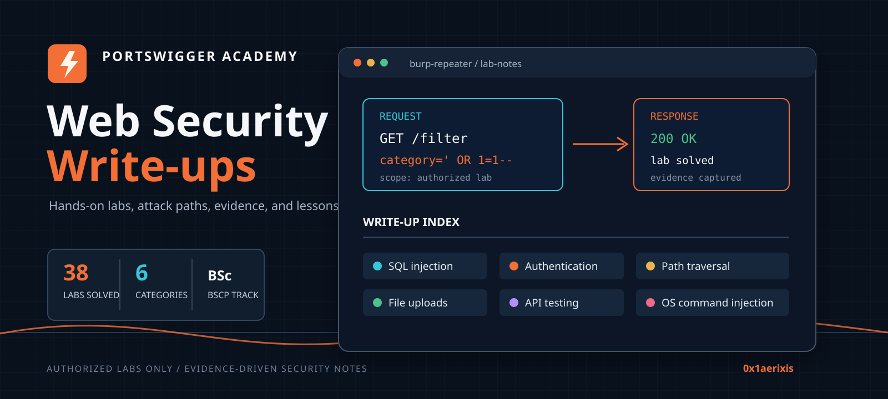

<div align="center">

<p align="center">
  
</p>

[](https://portswigger.net/web-security)
[](#coverage)
[](#coverage)

# PortSwigger Web Security Academy Write-ups

Practical, evidence-backed notes from solving PortSwigger Web Security Academy labs.

</div>

---

## About

This repository is a personal learning record and reference for web application security testing. Each published lab documents the observed behavior, the exploitation path, supporting evidence, and lessons learned. The material is intended for authorized training environments only.

The current repository contains **41 write-ups across 8 vulnerability categories**. It is an active collection rather than a complete mirror of the PortSwigger Academy curriculum; categories and labs are added as they are solved.

## Coverage

| Category | Write-ups | What is covered |
| --- | :---: | --- |
| [SQL injection](#sql-injection) | 16 | In-band, UNION, blind boolean/error/time-based, and out-of-band techniques |
| [File upload vulnerabilities](#file-upload-vulnerabilities) | 7 | Web shells, content-type and extension bypasses, polyglots, traversal, and race conditions |
| [Path traversal](#path-traversal) | 6 | Traversal filtering, encoding, absolute-path, extension, and null-byte bypasses |
| [API testing](#api-testing) | 4 | Exposed/unused endpoints, mass assignment, and server-side parameter pollution |
| [OS command injection](#os-command-injection) | 3 | Direct, time-based blind, and output-redirection techniques |
| [Authentication](#authentication) | 2 | Username enumeration through distinct and subtly different responses |
| [Business logic vulnerabilities](#business-logic-vulnerabilities) | 2 | Client-side control trust and cart quantity manipulation |
| [Information disclosure](#information-disclosure) | 1 | Sensitive information leaked through error messages |
| **Total** | **41** | **All write-ups currently published in this repository** |

## How to use this repository

1. Pick a category or follow the progression from basic input manipulation to blind and chained techniques.
2. Read the lab write-up before attempting the exercise if you want the methodology and reasoning.
3. Use the `evidence/` images to review the request/response behavior and completion proof.
4. Reproduce techniques only in the provisioned PortSwigger lab or another environment where you have explicit authorization.

The write-ups are intentionally explanatory rather than automated scanners. They use Burp Suite concepts such as Proxy, Repeater, Intruder, Collaborator, and Turbo Intruder where the lab requires them. A few labs also include small PHP or Python proof-of-concept helpers.

## Write-up format

Most write-ups follow a consistent penetration-testing structure:

- overview and scope
- objectives and methodology
- findings, impact, and attack chain
- proof of concept and reproduction steps
- tools and environment
- evidence
- remediation and retest criteria
- lessons learned and references

Severity, CVSS, CWE, OWASP, and MITRE ATT&CK references are included where they are relevant to the individual lab.

## Repository structure

```text
portswigger-web-security-writeups/
├── README.md
├── repo-image.svg
├── API testing/
├── Authentication/
├── Business Logic Vulnerability/
├── File upload vulnerabilities/
├── Information disclosure/
├── OS command injection/
├── Path Traversal/
└── sql-injection/
```

Each solved lab is self-contained:

```text
<category>/<lab>/
├── README.md       # write-up
├── evidence/       # screenshots and completion evidence
└── PoC files       # only where an exploit helper is useful
```

## Lab catalog

### SQL injection

1. [SQL injection in WHERE clause](<sql-injection/01-sqli-where-clause/>)
2. [SQLi login bypass](<sql-injection/02-sqli-login-bypass/>)
3. [UNION version disclosure on Oracle](<sql-injection/03-sqli-union-oracle-version-disclosure/>)
4. [UNION version enumeration on MySQL/Microsoft](<sql-injection/04-sqli-union-mysql-version-enum/>)
5. [UNION database enumeration](<sql-injection/05-sqli-union-db-enumeration/>)
6. [UNION database enumeration on Oracle](<sql-injection/06-sqli-oracle-union-db-enumeration/>)
7. [UNION column-count discovery](<sql-injection/07-sqli-union-column-count-null-probing/>)
8. [UNION text-column discovery](<sql-injection/08-sqli-union-finding-a-column-containing-text/>)
9. [UNION data extraction](<sql-injection/09-sqli-union-data-extraction/>)
10. [UNION multiple values in one column](<sql-injection/10-sqli-union-multiple-values-single-column/>)
11. [Blind SQLi with conditional responses](<sql-injection/11-sqli-blind-boolean-conditional-response-trackingid-cookie/>)
12. [Blind SQLi with conditional errors](<sql-injection/12-sqli-blind-conditional-errors/>)
13. [Visible error-based SQLi](<sql-injection/13-sqli-visible-error-based/>)
14. [Blind SQLi with PostgreSQL time delays](<sql-injection/14-sqli-blind-time-based-pg-sleep/>)
15. [Blind SQLi password extraction with time delays](<sql-injection/15-sqli-blind-time-based-password-extraction/>)
16. [Blind out-of-band SQLi via DNS interaction](<sql-injection/16-sqli-blind-oob-dns-interaction/>)

### File upload vulnerabilities

1. [Remote code execution via web shell](<File upload vulnerabilities/01-file-upload-rce-web-shell/>)
2. [Content-Type restriction bypass](<File upload vulnerabilities/02-file-upload-content-type-bypass/>)
3. [Path traversal upload bypass](<File upload vulnerabilities/03-file-upload-path-traversal-bypass/>)
4. [Extension blacklist bypass](<File upload vulnerabilities/04-lab-web-shell-upload-via-extension-blacklist-bypass/>)
5. [Obfuscated file extension](<File upload vulnerabilities/05-lab-web-shell-upload-via-obfuscated-file-extension/>)
6. [Polyglot web shell upload](<File upload vulnerabilities/06-lab-remote-code-execution-via-polyglot-web-shell-upload/>)
7. [Web shell upload race condition](<File upload vulnerabilities/07-web-shell-upload-race-condition/>)

### Path traversal

1. [Simple path traversal](<Path Traversal/01-lab-file-path-traversal-simple-case/>)
2. [Absolute-path bypass](<Path Traversal/02-lab-file-path-traversal-traversal-sequences-blocked-with-absolute-path-bypass/>)
3. [Non-recursive traversal stripping](<Path Traversal/03-lab-traversal-sequences-stripped-non-recursively/>)
4. [Superfluous URL decoding bypass](<Path Traversal/04-lab-file-path-traversal-traversal-sequences-stripped-with-superfluous-url-decode/>)
5. [Validation of path start bypass](<Path Traversal/05-lab-file-path-traversal-traversal-sequences-blocked-with-absolute-path-bypass/>)
6. [Null-byte extension validation bypass](<Path Traversal/06-lab-file-path-traversal-validation-of-file-extension-with-null-byte-bypass/>)

### API testing

1. [Exploiting API endpoint documentation](<API testing/01-lab-exploiting-api-endpoint-using-documentation/>)
2. [Finding and exploiting an unused endpoint](<API testing/02-lab-finding-and-exploiting-unused-api-endpoint/>)
3. [Mass assignment](<API testing/03-lab-mass-assignment/>)
4. [Server-side parameter pollution](<API testing/04-lab-server-side-parameter-pollution-query-string/>)

### OS command injection

1. [Simple OS command injection](<OS command injection/01-os-command-injection-simple-case/>)
2. [Blind injection with time delays](<OS command injection/02-blind-os-command-injection-time-delays/>)
3. [Blind injection with output redirection](<OS command injection/03-blind-os-command-injection-output-redirection/>)

### Authentication

1. [Username enumeration via different responses](<Authentication/01-lab-username-enumeration-via-different-responses/>)
2. [Username enumeration via subtly different responses](<Authentication/02-lab-username-enumeration-subtly-different-responses/>)

### Business logic vulnerabilities

1. [Excessive trust in client-side controls](<Business Logic Vulnerability/01-excessive-trust-client-side-controls/>)
2. [High-level logic vulnerability](<Business Logic Vulnerability/03-high-level-logic-vulnerability/>)

### Information disclosure

1. [Information disclosure in error messages](<Information disclosure/01-infoleak-error-messages/>)

## Tools and artifacts

- **Burp Suite** for HTTP interception, request manipulation, Intruder, Collaborator, and Turbo Intruder workflows.
- **PHP web-shell payloads** for the file-upload labs.
- **Python helpers** for blind SQL injection extraction and the file-upload race-condition lab.
- **Screenshots** in each `evidence/` directory for exploitation and solved-state verification.

These artifacts are intentionally small and lab-specific. Review their contents and adapt them only for authorized testing.

## References

- [PortSwigger Web Security Academy](https://portswigger.net/web-security)
- [PortSwigger Web Security Academy topics](https://portswigger.net/web-security/all-topics)
- [OWASP Top 10](https://owasp.org/www-project-top-ten/)
- [MITRE ATT&CK](https://attack.mitre.org/)

## Author

Maintained by [Michael Asante Anim](https://github.com/anim-michael-asante).
